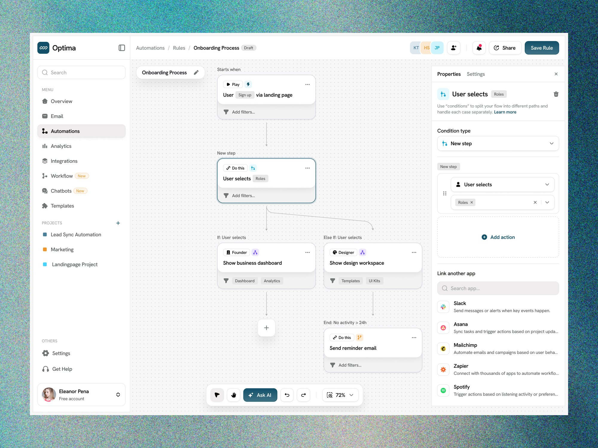

# Workflows

A drag-and-drop builder for automation rules, built with Next.js, React and Motion.



## Features

- **Canvas**: pan, zoom and drag steps around; connectors re-route as you move them.
- **Steps**: continue a path with **+**, split a condition into role-based paths, limit any step to certain roles, and give each step an ordered list of actions.
- **Apps**: drag Slack, Asana, Mailchimp, Zapier or Spotify onto the canvas to create a step, or onto a step's **Add action** box to add it there.
- **Safe edits**: every change can be undone, and deletes that would break the flow are refused with a reason.
- **Persistence**: drafts are stored in PostgreSQL and can be saved across reloads.
- **Publishing**: publish an immutable workflow version; saved and published snapshots are retained in version history.
- **Motion**: cards, connectors, the panel and menus animate in and out, and reduced-motion settings are respected.
- **Keyboard**: every control is reachable without a mouse.

## Getting started

You'll need Node.js 20.9 or later.

```bash
npm install
npm run dev
```

Then open [http://localhost:3000](http://localhost:3000).

## Database setup

Workflow drafts and versions use a dedicated PostgreSQL database, separate from n8n's internal database.

1. Copy `.env.example` to `.env.local` and configure the dedicated PostgreSQL connection and the server-side n8n API and webhook settings.
2. Apply migrations 001 and 002, run the integration permission test, then apply migration 003 as described in [the PostgreSQL integration contract](docs/postgres-integration-contract.md).
3. Restart the development server.

The database-backed API is currently a single-user prototype without application authentication. Do not expose it publicly until an access gate is configured.

## Scripts

| Command                | What it does                      |
| ---------------------- | --------------------------------- |
| `npm run dev`          | Start the dev server              |
| `npm run build`        | Build for production              |
| `npm run start`        | Serve the production build        |
| `npm run lint`         | Lint with ESLint                  |
| `npm run format`       | Format with Prettier              |
| `npm run format:check` | Check formatting without changing |

## Keyboard shortcuts

| Keys                                          | Action                                     |
| --------------------------------------------- | ------------------------------------------ |
| <kbd>V</kbd> / <kbd>H</kbd>                   | Select tool / pan tool                     |
| Hold <kbd>Space</kbd>                         | Pan while held                             |
| Arrow keys                                    | Nudge the selected step (with Shift: more) |
| <kbd>Delete</kbd>                             | Delete the selected step                   |
| <kbd>Ctrl</kbd> <kbd>Z</kbd>                  | Undo                                       |
| <kbd>Ctrl</kbd> <kbd>Shift</kbd> <kbd>Z</kbd> | Redo                                       |
| <kbd>Ctrl</kbd> + scroll                      | Zoom                                       |

On macOS, use <kbd>⌘</kbd> in place of <kbd>Ctrl</kbd>.

## Project structure

```
.github/workflows/        GitHub Actions workflows
app/                      Next.js app, global styles and API routes
  api/
    executions/[id]/      Execution details and cancellation
    workflows/            Workflow creation and retrieval
      [id]/
        executions/       Start and list executions
        publish/          Publish workflow versions
        versions/         Published version history
components/
  automation-builder.tsx  Main Automations screen
  builder/                Editor state, canvas, properties panel and execution history
    canvas/               Canvas, step cards, connectors and toolbar
    panel/                Step properties and action configuration
  icons/                  Phosphor icons and original glyphs
  shell/                  Sidebar and top bar
  ui/                     Shared UI components
db/
  migrations/             PostgreSQL schema and integration migrations
  tests/                  Database permission and persistence tests
docs/                     Backend API, database contract and preview
lib/
  flow/                   Workflow model, catalogue, geometry and edits
  server/                 Database access, validation and n8n integration
  use-history.ts          Undo/redo history hook
```

The workflow model in `lib/flow` is plain data and pure functions with no React. Server-only database and n8n operations live in `lib/server`; the `app/api` routes expose workflow, publishing and execution operations.

## Recent implementations

- **n8n execution integration**: workflows can be translated into n8n workflows, activated and dispatched through webhooks. Execution status and node results are synchronized back into the application when history or execution details are requested.
- **Execution history**: view test and production execution records from the editor, expand individual executions and inspect their step results. History refreshes automatically every 15 seconds while open.
- **Immutable workflow versions**: published version snapshots are protected against in-place modification.
- **Database resilience**: workflow loading retries transient PostgreSQL connection failures, without retrying application or permission errors.

## Status

This is an early single-user prototype. Drafts persist in the dedicated Workflows PostgreSQL database, and publishing creates immutable version snapshots. n8n execution is integrated, including execution tracking and history synchronization. Action steps currently produce structured action descriptors; actual third-party actions such as sending emails or messages are not implemented yet.

The Automations screen is the primary built interface. Other navigation items, **Ask AI**, **Invite**, notifications, **New project**, the account menu, the **⋯** on each step and the **Learn more** links remain placeholders.

## Built with

[Next.js](https://nextjs.org), [React](https://react.dev), [TypeScript](https://www.typescriptlang.org), [Tailwind CSS](https://tailwindcss.com), [Motion](https://motion.dev), [Phosphor Icons](https://phosphoricons.com) and the [Figtree](https://fonts.google.com/specimen/Figtree) typeface. All interface icons are Phosphor (MIT) or drawn for this project. Logos for linked apps load from [Dashboard Icons](https://dashboardicons.com) and belong to their respective owners.

## License

[MIT](LICENSE)
